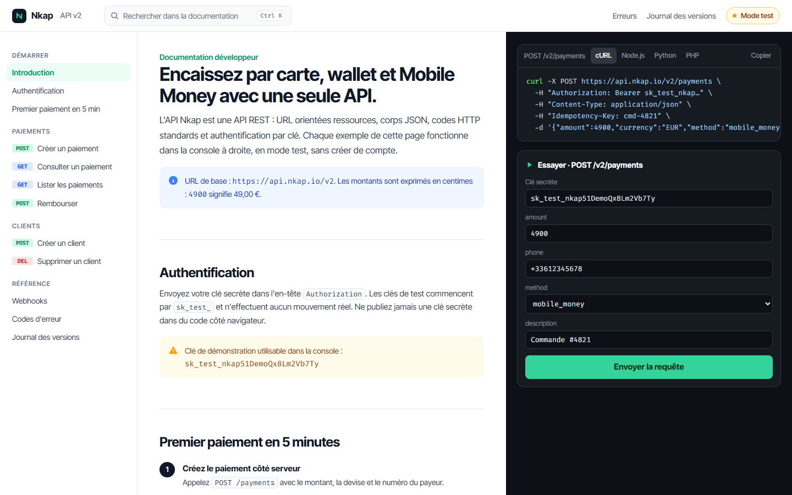
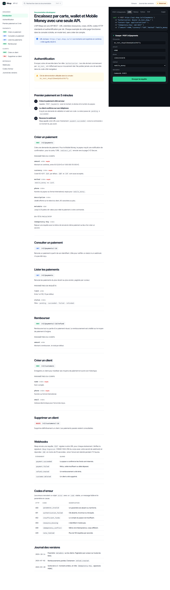
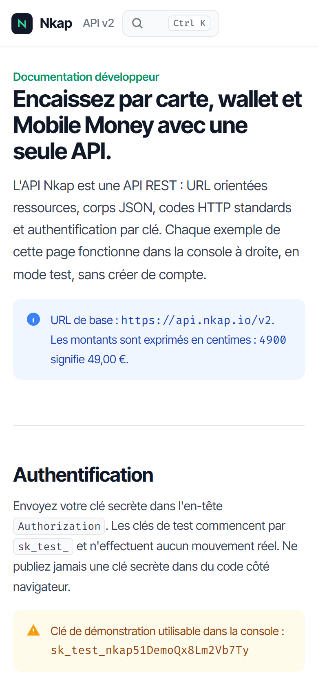

# Nkap API

**Documentation développeur d'API** — Portail de documentation pour une API de paiement par carte, wallet et Mobile Money : guide de démarrage, référence de six points d'accès avec paramètres, exemples générés en cURL, Node.js, Python et PHP, console d'essai branchée sur un serveur simulé qui valide les entrées, renvoie les vrais codes HTTP et émet des webhooks signés. Recherche instantanée au clavier.

**Démo en ligne : [https://lordlennyx.github.io/nkap-documentation-api/](https://lordlennyx.github.io/nkap-documentation-api/)**

Spot de présentation (30 s) : [media/spot-30s.mp4](https://lordlennyx.github.io/nkap-documentation-api/media/spot-30s.mp4)

## Ce que le projet montre

- Référence des points d'accès : paiements, remboursements, clients, avec paramètres requis et types
- Exemples de code générés à partir des valeurs saisies, en quatre langages, copiables
- Console d'essai : validation, codes 201, 400, 401, 402, 404, latence, identifiant de requête
- Cycle de vie simulé : paiement en attente puis réussi, remboursement partiel, webhooks signés
- Exemple qui suit la section lue, recherche Ctrl+K, table des erreurs et journal des versions

## Réalisation

- **Stack :** HTML, CSS, JavaScript natif
- **Typographies :** Inter Tight, Fira Code
- **Évolutions possibles :** génération depuis un fichier OpenAPI, SDK publiés, tableau de bord des clés, journal des requêtes réelles

| Bureau | Mobile |
|---|---|
|  |  |

---

Client et contenus fictifs, créés pour la démonstration. Conception, design et développement : **Njundiyimun Béchard** — [github.com/LordLennyx](https://github.com/LordLennyx)
